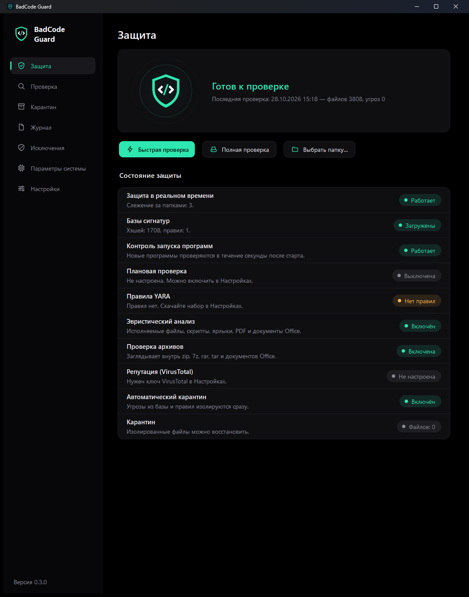
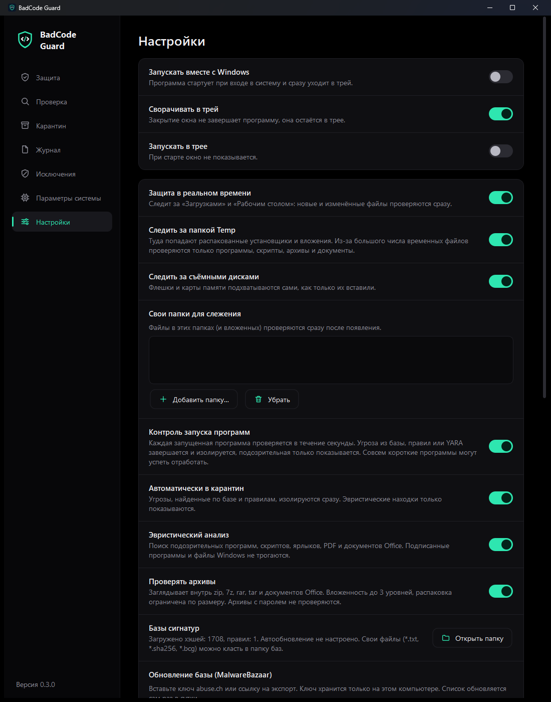

# BadCode Guard

Антивирус для Windows 10/11 с открытым кодом на C++ и Qt 6. Проверяет файлы по базам хэшей,
правилам YARA и эвристике, следит за папками и запускаемыми программами, изолирует угрозы
в карантин и ведёт журнал.

*English: [README.en.md](README.en.md)*



> **Важно.** Это учебный и экспериментальный проект, а не замена Microsoft Defender. Он не
> содержит драйвера ядра, не блокирует запуск до проверки и опирается на небольшие открытые
> базы. Используйте его вместе с обычной защитой Windows, а не вместо неё.

## Возможности

**Проверка**
- Быстрая (загрузки, рабочий стол, Temp), полная и выбранной папки. Точная полоса прогресса
  и оценка оставшегося времени.
- Хэши SHA-256: бесплатный список MalwareBazaar, собственные списки, любые дополнительные ссылки.
- Правила YARA (libyara): свои файлы `*.yar` или набор сообщества Yara-Rules по кнопке.
- Эвристика: исполняемые файлы (PE), скрипты (PowerShell, bat, js, vbs, hta), ярлыки, PDF, документы Office.
- Архивы: zip, jar, Office-документы, 7z, rar, tar, gz, cab, iso и другие (вложенность до 3 уровней,
  ограничения на размер; архивы с паролем не проверяются).
- Репутация по хэшу через VirusTotal (нужен ваш ключ; файл не отправляется).

**Защита**
- Реальное время: «Загрузки», «Рабочий стол», `Temp`, съёмные диски, свои папки.
- Контроль запуска: новая программа проверяется в течение секунды, угроза завершается и изолируется.
- Карантин с восстановлением, исключения, плановая проверка, журнал находок с экспортом в CSV.
- Ключи хранятся зашифрованными (Windows DPAPI), необязательная защита процесса от остановки.



## Установка

1. Скачайте `BadCodeGuard-<версия>-win64.zip` из раздела **Releases**.
2. Сверьте контрольную сумму с `SHA256SUMS.txt`:
   `Get-FileHash BadCodeGuard-<версия>-win64.zip -Algorithm SHA256`
3. Распакуйте и запустите `BadCodeGuard.exe`. Установка не нужна.

Если exe не подписан, Windows SmartScreen покажет предупреждение «Windows защитила ваш
компьютер». Это ожидаемо для новых программ без репутации издателя: «Подробнее → Выполнить
в любом случае». Подробности про подпись и доверие: [docs/SIGNING.md](docs/SIGNING.md).
Некоторые антивирусы могут ошибочно ругаться на программу, которая сама изолирует и завершает
процессы; исходный код открыт, можно проверить и собрать самостоятельно.

## Первый запуск: база сигнатур

В поставке всего один тестовый хэш (EICAR). Чтобы программа находила настоящие угрозы:

1. Зарегистрируйтесь на [abuse.ch](https://abuse.ch/) и получите бесплатный ключ для MalwareBazaar.
2. **Настройки → Обновление базы**: вставьте ключ (или ссылку на экспорт) и нажмите «Обновить базу».
   Дальше база обновляется сама раз в сутки.
3. По желанию: **Настройки → Правила YARA → Скачать набор правил**.

## Сборка из исходников

Нужны Visual Studio с рабочей нагрузкой «Разработка классических приложений на C++»,
Qt 6.8+ для MSVC 2022 64-bit и CMake.

```
build.bat
```

Если Qt стоит не в `C:\Qt`, задайте `QT_DIR`, например `set QT_DIR=D:\Qt\6.8.3\msvc2022_64`.
Результат: `dist\BadCodeGuard.exe` с библиотеками Qt рядом.

Тесты:

```
cmake --build build --target bcg_tests
build\bcg_tests.exe
powershell -File tests\ui_smoke.ps1 -Exe dist\BadCodeGuard.exe
```

Релизный архив с контрольной суммой: `powershell -File tools\package.ps1`.

## Устройство проекта

```
src/engine/   движок: хэши, правила, YARA, эвристики, архивы, карантин, наблюдатели
src/sys/      системный слой: реестр, обновление баз, VirusTotal, DPAPI, расписание
src/ui/       интерфейс Qt Widgets
tests/        автотесты движка и проверка интерфейса
third_party/  YARA и miniz (с лицензиями)
tools/        подпись и упаковка релиза
docs/         документация
```

## Данные и приватность

- Данные программы лежат в `%LOCALAPPDATA%\BadCodeGuard\BadCodeGuard` (карантин, журнал, базы).
- Телеметрии нет. В сеть программа обращается только за обновлением списков (abuse.ch и ссылки,
  которые вы сами указали), за набором YARA (github.com) и, если вы ввели ключ, в VirusTotal
  (отправляется только хэш файла).
- Подробнее: [SECURITY.md](SECURITY.md).

## Известные ограничения

- Нет перехвата запуска на уровне ядра: контроль запуска обнаруживает программу вскоре после
  старта, очень короткая может успеть завершиться.
- Макросы Office распознаются слабо: код VBA хранится сжатым.
- Правила сообщества YARA иногда срабатывают на безопасные файлы. Проверяйте находки, из карантина
  файл можно вернуть.
- Распаковка `7z`/`rar` и других форматов идёт через `tar.exe` из Windows; редкие варианты RAR
  он может не открыть.

## Участие и лицензия

См. [CONTRIBUTING.md](CONTRIBUTING.md). Код распространяется по лицензии [MIT](LICENSE);
сторонние компоненты перечислены в [THIRD_PARTY_NOTICES.md](THIRD_PARTY_NOTICES.md).
История версий: [CHANGELOG.md](CHANGELOG.md).
